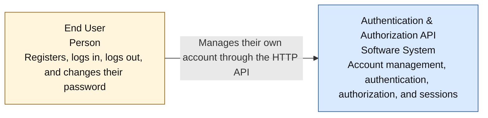

# C4 L1 — System Context

**Status: proposed architecture.** The focus is the Authentication & Authorization API Service as a single software system.

**Legend:** The yellow box represents an end user (Person), while the blue box represents the software system (Software System). The arrow shows the interaction between the user and the API service. This diagram illustrates the overall system context rather than the sequence of individual HTTP requests.

## System Description

The Authentication & Authorization API Service provides an API for managing user accounts. Users can interact with the service through Swagger UI, a CLI, a web application, or another HTTP client.

The system provides four core functions:

- **Registration** — creates an account using an email address and a password.
- **Login** — verifies credentials and authenticates the user.
- **Logout** — terminates the user's current session.
- **Password change** — changes the user's password.

The API validates input data using Pydantic. A password must be 8–24 characters long and include digits, lowercase and uppercase Latin letters, and permitted special characters. The characters `@`, `"`, `'`, `<`, and `>` are prohibited.

The service processes requests asynchronously, using `uvloop` as its main event loop.

## System Boundary

The Authentication & Authorization API Service includes authentication logic, input validation, session management, and user data storage.

Internal elements such as the API application, database, and IPython shell are not shown at L1. They are described in more detail in [L2](c4-level-2.md).

The task requirements do not specify integration with external identity providers or email delivery services, so neither appears in the diagram.

**Diagram source:** Mermaid block in this Markdown file. Method: [C4 — System Context Diagram](https://c4model.com/diagrams/system-context).
