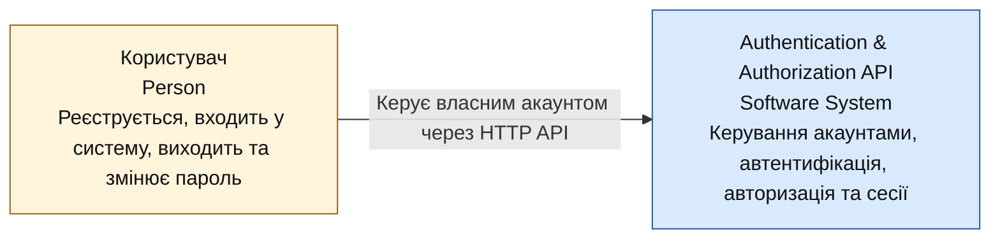

# C4 L1 — System Context

**Статус: запропонована архітектура.** У фокусі — Authentication & Authorization API Service як єдина програмна система.

**Легенда:** жовтий блок — користувач (Person), синій — програмна система (Software System). Стрілка показує взаємодію між користувачем та API-сервісом. Схема демонструє загальний контекст системи, а не послідовність окремих HTTP-запитів.

## Опис системи

Authentication & Authorization API Service — система, яка надає API для керування обліковими записами користувачів. Користувач може взаємодіяти із сервісом через Swagger UI, CLI, вебзастосунок або інший HTTP-клієнт.

Система надає чотири основні функції:

- **Registration** — створення акаунта за email і паролем.
- **Login** — перевірка облікових даних та автентифікація користувача.
- **Logout** — завершення поточної сесії користувача.
- **Password change** — зміна пароля користувача.

API перевіряє вхідні дані через Pydantic. Пароль повинен містити від 8 до 24 символів, цифри, великі й малі латинські літери та дозволені спеціальні символи. Символи `@`, `"`, `'`, `<`, `>` заборонені.

Сервіс обробляє запити асинхронно, використовуючи `uvloop` як основний event loop.

## Межі системи

До Authentication & Authorization API Service належать логіка автентифікації, перевірка вхідних даних, керування сесіями та збереження інформації про користувачів.

Внутрішні компоненти, такі як API-застосунок, база даних та IPython shell, не показані на L1. Їх детальніше описано на [L2](c4-level-2.md).

У вимогах не зазначено необхідності інтеграції із зовнішніми провайдерами автентифікації або сервісами надсилання електронних листів, тому на діаграмі вони відсутні.

**Джерело діаграми:** Mermaid-блок у Markdown. Метод: [C4 — System Context Diagram](https://c4model.com/diagrams/system-context).
