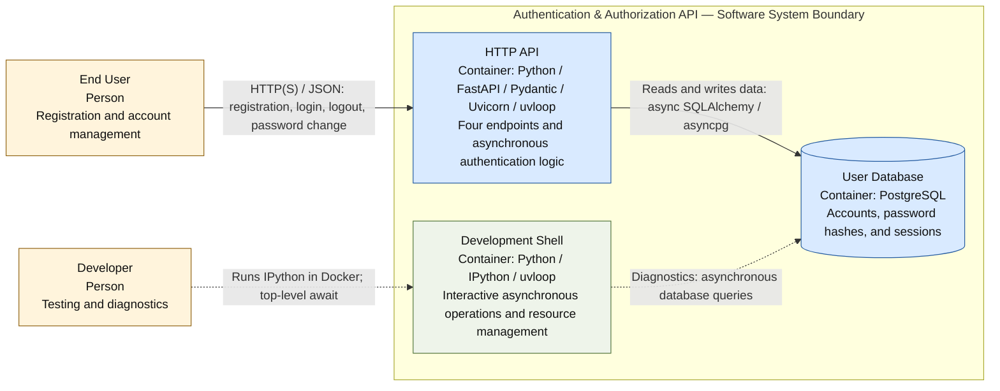

# C4 L2 — Containers

**Status: proposed architecture.** This diagram details the internal structure of the Authentication & Authorization API Service introduced in [L1](c4-level-1.md).

**Legend:** Yellow boxes represent people (Person), blue boxes represent the main system containers, and the green box represents a developer tool. Solid arrows show the primary application workflow; dashed arrows show interactions between the developer and the development environment. The dashed boundary encloses the software system from L1.

## Container Descriptions

| Container | Technologies | Responsibility |
|---|---|---|
| **HTTP API** | Python, FastAPI, Pydantic, Uvicorn, uvloop | Accepts HTTP requests, validates input, and handles registration, login, logout, and password changes. |
| **User Database** | PostgreSQL | Stores accounts, password hashes, and session state to support logout. |
| **Development Shell** | Python, IPython, uvloop | Provides developers with interactive asynchronous access to service logic and external resource connections. |

## Container Interactions

The user sends requests to the **HTTP API** through an HTTP client. Pydantic validates email addresses and passwords. After successful registration, the API creates an account; during login, it verifies credentials and creates a session; during logout, it terminates the session; and during a password change, it updates the stored password hash. Data is read from and written to the database asynchronously.

The **Development Shell** runs in Docker as a separate process and allows developers to use `await` in IPython. It can reuse the service's application code, but it has its own event loop and connection lifecycle. Open database connections are not shared between the API and shell processes.

## Key Technical Decisions

- **Validation:** Pydantic validates all input data. Email addresses must be valid. Passwords must be 8–24 characters long and contain at least one digit, one lowercase letter, one uppercase letter, and one permitted special character. The characters `@`, `"`, `'`, `<`, and `>` are forbidden.
- **Security:** Passwords are stored as cryptographic hashes rather than plaintext. The specific hashing algorithm and session format will be selected during implementation.
- **Asynchronous processing:** The API and external resource operations are asynchronous. `uvloop` is the main event loop in the Linux Docker environment; exceptions from asynchronous functions are handled within asynchronous execution flows.
- **Lifecycle:** Connections to external resources are created at startup and properly closed when the API or development shell shuts down, including in error scenarios.
- **Testing:** Tests cover all four API functions, valid and invalid input, and error handling. Tests are not shown as a separate container because they are not part of the running system.

**Note:** FastAPI, Uvicorn, PostgreSQL, SQLAlchemy, and asyncpg are proposed implementation technologies, not mandatory technologies specified in Task 20. The requirements explicitly name Pydantic, uvloop, IPython, and Docker.

**Diagram source:** Mermaid block in this Markdown file. Method: [C4 — Container Diagram](https://c4model.com/diagrams/container).
