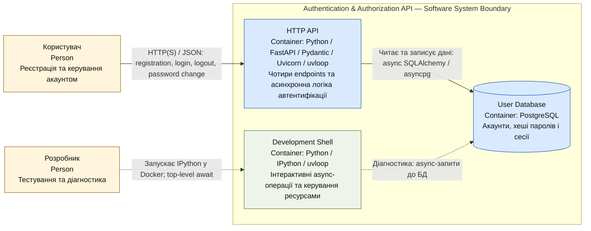

# C4 L2 — Containers

**Статус: запропонована архітектура.** Деталізація внутрішньої структури системи Authentication & Authorization API Service із [L1](c4-level-1.md).

**Легенда:** жовті блоки — ролі людей (Person), сині — основні контейнери системи, зелений — інструмент розробника. Суцільні стрілки відображають основний робочий процес; пунктирні — взаємодію розробника з середовищем. Пунктирна рамка позначає межу програмної системи з L1.

## Опис контейнерів

| Контейнер | Технології | Відповідальність |
|---|---|---|
| **HTTP API** | Python, FastAPI, Pydantic, Uvicorn, uvloop | Приймає HTTP-запити, перевіряє дані, виконує сценарії реєстрації, входу, виходу та зміни пароля. |
| **User Database** | PostgreSQL | Зберігає акаунти, хеші паролів та стан сесій для підтримки logout. |
| **Development Shell** | Python, IPython, uvloop | Надає розробнику інтерактивний асинхронний доступ до логіки сервісу та підключень зовнішніх ресурсів. |

## Взаємодія контейнерів

Користувач надсилає запити до **HTTP API** через HTTP-клієнт. Pydantic перевіряє email і пароль. При успішній реєстрації API створює акаунт; при вході перевіряє облікові дані й формує сесію; при виході завершує її; при зміні пароля оновлює збережений хеш. Збереження і читання даних виконується асинхронно через базу даних.

**Development Shell** запускається у Docker як окремий процес і дозволяє виконувати `await` в IPython. Він може використовувати спільний код сервісу, але має власний event loop і lifecycle підключень. Відкриті підключення до бази даних не передаються між процесами API та shell.

## Основні технічні рішення

- **Валідація:** усі вхідні дані перевіряються Pydantic. Email має бути коректним. Пароль — 8–24 символи, щонайменше одна цифра, одна мала й велика літера, один дозволений спецсимвол; `@`, `"`, `'`, `<`, `>` заборонені.
- **Безпека:** паролі зберігаються як криптографічні хеші, а не у відкритому вигляді. Конкретний алгоритм хешування та формат сесій визначаються під час реалізації.
- **Асинхронність:** API та операції із зовнішніми ресурсами працюють асинхронно. `uvloop` виступає основним циклом подій у Linux Docker; помилки з асинхронних функцій обробляються в асинхронному потоці виконання.
- **Lifecycle:** підключення до зовнішніх ресурсів створюються при запуску та коректно закриваються при завершенні API або dev shell, зокрема після помилок.
- **Тестування:** тести охоплюють чотири функції API, коректні й некоректні вхідні дані та обробку помилок. Тести не показані як окремий контейнер, оскільки не є частиною працюючої системи.

**Джерело діаграми:** Mermaid-блок у Markdown. Метод: [C4 — Container Diagram](https://c4model.com/diagrams/container).
